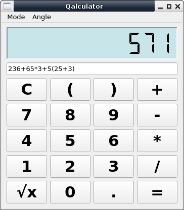
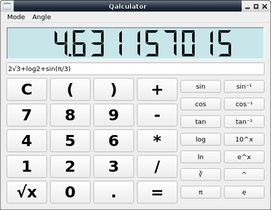

# Qalculator

A simple and scientific Calculator with LCD display  

### Description

This is a very simple calculator.  
It has also scientific mode functions (sin, cos, log, ln).  
View the answer in LCD display like widget.  

### Installation
First Install dependencies...  
* python3-pyqt6  
* pyqt6-dev-tools  

To Install qalculator open terminal inside project root directory.  
And then run following command..  
`$ sudo pip3 install --no-build-isolation .`  

To uninstall run..  
`$ sudo pip3 uninstall qalculator`  

### Screenshots

Simple Calculator Mode  
  

Scientific Calculator Mode  
  

